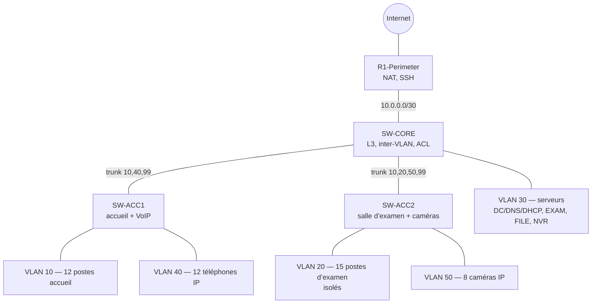

# Network Segmentation Lab — centre d’examens

🇫🇷 [Français](#-français) · 🇬🇧 [English](#-english)

---

## 🇫🇷 Français

### Contexte

Projet de semestre réalisé à VILNIUS TECH (2025) : planification de l’infrastructure informatique d’une
nouvelle antenne de **centre d’examens** (accueil du public, salle d’examen théorique, vidéosurveillance,
téléphonie). Le scénario est fictif ; aucune donnée réelle d’organisation n’est utilisée.

Ce dépôt présente la partie **architecture réseau** : segmentation en VLAN, routage inter-VLAN,
isolation de la salle d’examen et maquette Cisco Packet Tracer.

### Segmentation

| VLAN | Nom | Réseau | Contenu | Accès Internet |
|---|---|---|---|---|
| 10 | CUSTOMER_SERVICE | 192.168.10.0/24 | postes d’accueil, surveillant d’examen | oui |
| 20 | EXAMS | 192.168.20.0/24 | 15 postes d’examen (DHCP 100–150) | **non** |
| 30 | SERVERS | 192.168.30.0/24 | SRV-DC .10, SRV-EXAM .20, SRV-FILE .30, SRV-NVR .40 | oui |
| 40 | VOIP | 192.168.40.0/24 | téléphones IP | non |
| 50 | CAMERAS | 192.168.50.0/24 | caméras IP | **non** |
| 99 | MANAGEMENT | 192.168.99.0/24 | administration des équipements | non |
| 999 | PARKING_UNUSED | — | ports inutilisés, VLAN natif des trunks | — |

Passerelle `.1` dans chaque VLAN (interfaces SVI du commutateur cœur).

### Règles de sécurité

| Source | Autorisé | Interdit |
|---|---|---|
| Postes d’examen (VLAN 20) | DHCP, serveur d’examen, DNS | Internet et tous les autres VLAN |
| Caméras (VLAN 50) | enregistreur NVR | tout le reste |
| Administration (SSH) | depuis le VLAN 99 uniquement | Telnet, console sans authentification |

### Deux versions de la configuration

- [`configs/original/`](configs/original) — configuration rendue pendant le cours, telle quelle
  (commentaires traduits en anglais). Le fichier [`packet-tracer/exam-center-original.pkt`](packet-tracer) correspond à cette version.
- [`configs/hardened/`](configs/hardened) — version **revue et durcie** après coup.

Ce que la revue a corrigé ou ajouté :

| Problème trouvé dans l’original | Correction |
|---|---|
| Le lien R1 ↔ cœur n’avait pas d’adresse IP : aucun VLAN ne pouvait sortir vers Internet | lien routé /30, route par défaut, NAT limité aux VLAN autorisés |
| L’ACL de la salle d’examen bloquait aussi le DHCP | `permit udp any any eq bootps` + `ip helper-address` |
| Le poste du surveillant était dans le VLAN d’examen isolé, alors qu’il doit voir les caméras | déplacé dans le VLAN 10 |
| Caméras sans filtrage | ACL : caméras → NVR uniquement |
| Pas de sécurité d’administration | SSH v2, comptes locaux, ACL sur les lignes VTY, bannière, délai d’inactivité |
| Ports d’accès sans protection | port-security (1 appareil par poste d’examen, coupure en cas de violation), BPDU guard, DHCP snooping |
| Trunks négociés automatiquement | `nonegotiate`, VLAN natif inutilisé, VLAN autorisés réduits |
| Ports inutilisés actifs | désactivés et placés dans le VLAN 999 |

> La version durcie n’a pas encore été rejouée dans Packet Tracer. Les mots de passe sont remplacés par
> `<CHANGE_ME>` : aucun secret n’est publié. Pour le VLAN 10, un pool DHCP doit être ajouté sur SRV-DC.

### Dimensionnement (extrait du projet)

- **Serveurs** : 2 serveurs physiques virtualisés (production + sauvegarde / NVR), SSD RAID 1 pour le système, RAID 5 pour les données, alimentations redondantes.
- **Vidéosurveillance** : 16 caméras, 30 jours d’archives en H.265 ≈ 6–8 To.
- **Onduleur** : charge critique ≈ 1,5 kW → onduleur *online* 3 000 VA, 15–20 min d’autonomie, arrêt propre des serveurs après 5 min de coupure.

### Ouvrir le lab

1. Installer Cisco Packet Tracer (gratuit avec un compte Cisco Networking Academy).
2. Ouvrir `packet-tracer/exam-center-original.pkt`.
3. Pour tester la version durcie : coller les fichiers de `configs/hardened/` dans la CLI de chaque équipement.

---

## 🇬🇧 English

### Context

Semester project at VILNIUS TECH (2025): IT infrastructure planning for a new branch of an **exam centre**
(public service desks, theory exam room, CCTV, IP telephony). The scenario is fictional; no real
organisation data is used.

This repository covers the **network architecture** part: VLAN segmentation, inter-VLAN routing,
isolation of the exam room and a Cisco Packet Tracer model.

### Segmentation

| VLAN | Name | Network | Hosts | Internet |
|---|---|---|---|---|
| 10 | CUSTOMER_SERVICE | 192.168.10.0/24 | service desk PCs, exam supervisor | yes |
| 20 | EXAMS | 192.168.20.0/24 | 15 exam PCs (DHCP 100–150) | **no** |
| 30 | SERVERS | 192.168.30.0/24 | SRV-DC .10, SRV-EXAM .20, SRV-FILE .30, SRV-NVR .40 | yes |
| 40 | VOIP | 192.168.40.0/24 | IP phones | no |
| 50 | CAMERAS | 192.168.50.0/24 | IP cameras | **no** |
| 99 | MANAGEMENT | 192.168.99.0/24 | device management | no |
| 999 | PARKING_UNUSED | — | unused ports, trunk native VLAN | — |

### Security rules

| Source | Allowed | Denied |
|---|---|---|
| Exam PCs (VLAN 20) | DHCP, exam server, DNS | Internet and every other VLAN |
| Cameras (VLAN 50) | NVR | everything else |
| Management (SSH) | from VLAN 99 only | Telnet, unauthenticated console |

### Original vs. hardened

- `configs/original/` — the configuration submitted for the course (comments translated), matching the `.pkt` file.
- `configs/hardened/` — reviewed version. Fixes: missing routed link to the edge router (no Internet access at all),
  exam ACL blocking DHCP, supervisor PC stuck in the isolated exam VLAN, unfiltered cameras.
  Additions: SSH v2 with VTY ACL, port security, BPDU guard, DHCP snooping, trunk hardening, unused ports disabled.

> The hardened version has not yet been replayed in Packet Tracer. Passwords are `<CHANGE_ME>` placeholders.

### Sizing (from the project)

Two virtualised physical servers (production + backup/NVR), 16 cameras with 30-day H.265 retention (~6–8 TB),
3 000 VA online UPS for ~1.5 kW of critical load with 15–20 min runtime and graceful server shutdown.

---

Configurations et documentation rédigées avec l’aide d’un assistant IA, relues par l’auteur. · Licence MIT
